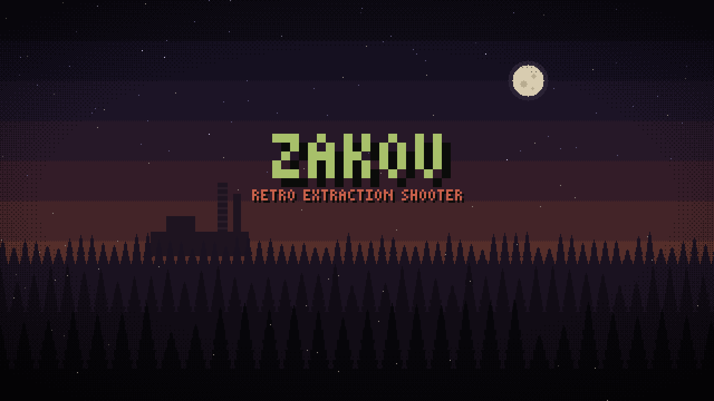
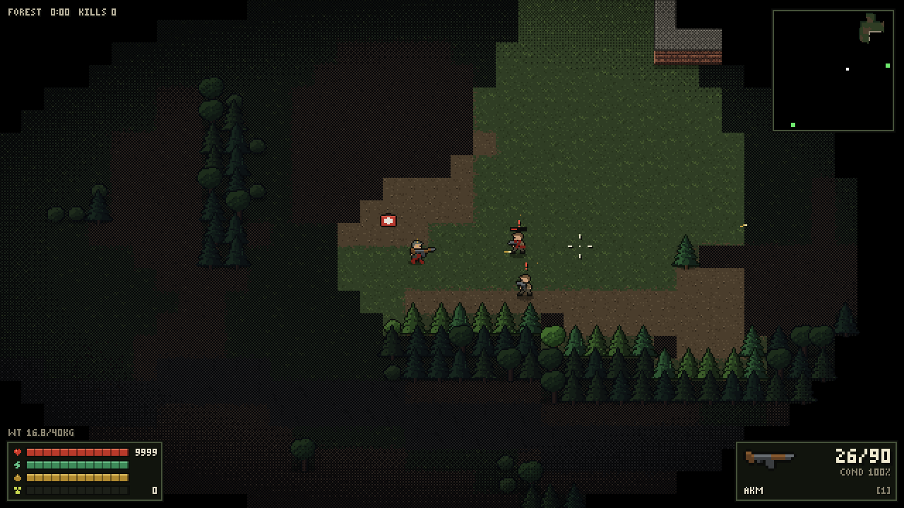
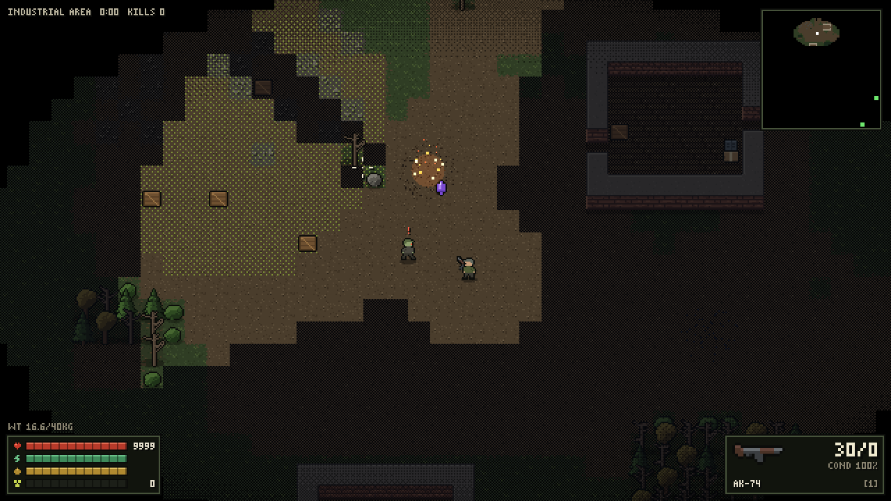
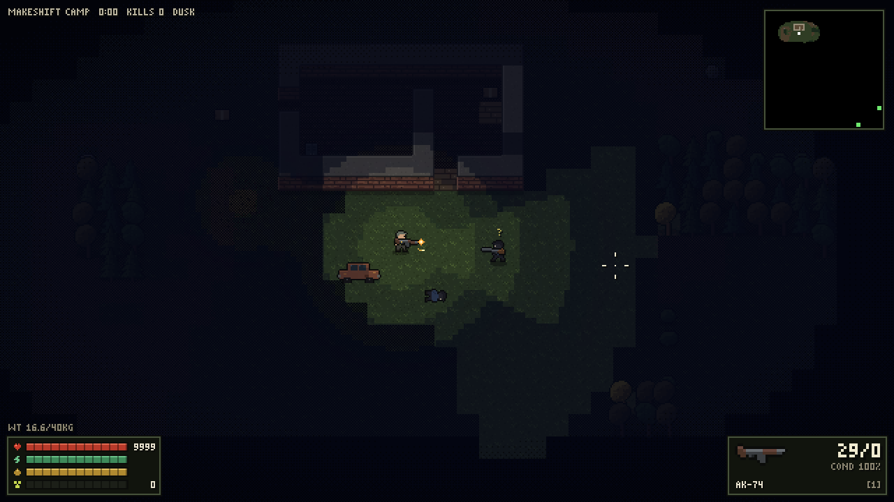

# ZAKOV

A retro pixel-art extraction shooter that runs in the browser, inspired by ZERO Sievert.

The reactor went up years ago. You are a hunter living in a bunker under Zakov. Go out, loot, come back alive. Die out there and everything you carried is gone.

**[Play it in your browser](https://underscorelog.github.io/zakov/)**

| | |
|---|---|
|  |  |
|  | |

## Features

- **Extraction loop**: raid a procedurally generated map, loot containers and bodies, reach a green extraction zone. Your stash in the bunker is safe; your carried gear is not.
- **3 maps**: Forest (low threat), Makeshift Camp (medium), Industrial Area (high). Each raid has a new layout, and some raids happen at dusk.
- **Enemies with senses**: bandits, scavs and Crimson Corp. soldiers see in a cone, hear gunshots and footsteps, alert their squad, strafe under fire, and flee when badly hurt and alone. Wolves and ghouls hunt in the wild.
- **Survival**: health, stamina, hunger, bleeding, radiation zones, fire and electric anomalies (with artifacts nearby).
- **Gear**: 6 weapons, ammo calibers, armor classes vs. penetration, helmets, weapon condition, carry weight.
- **The bunker**: stash, Barman shop and jobs, medic, XP and levels. Progress is saved in your browser.

## Retro rendering

- The world is drawn into a low-resolution buffer (16px tiles) and upscaled with hard, integer pixels.
- All art is generated in code at startup: pixel sprites, pines, walls, props, item icons, and a bitmap font. There are no image files.
- 3/4-view brick buildings, y-sorted scene, see-through tree canopies.
- Dithered fog of war, posterized light map at dusk with a flashlight cone, CRT scanlines (toggle with `C`).
- Blood and brass casings stay on the ground for the whole raid.

## Controls

| Key | Action |
|---|---|
| `W A S D` | move |
| `Shift` | sprint |
| Mouse / `LMB` | aim / fire |
| `R` | reload |
| `E` | interact, loot, search |
| `Tab` | backpack |
| `1` / `2` | switch weapon |
| `Q` / `H` / `G` | bandage / medkit / eat |
| `Esc` | close panel |
| `C` | toggle CRT filter |

## Run locally

It is a single `index.html` with no build step and no dependencies. Open it in a browser, or serve the folder with any static server.

The only external request is Google Fonts (Press Start 2P and VT323) for the menus. Without a connection, the menus fall back to a monospace font and the game still works.

## Credits

- Inspired by [ZERO Sievert](https://store.steampowered.com/app/1782120/ZERO_Sievert/) by CABO Studio. This is an unofficial fan project, not affiliated with it.
- Fonts: [Press Start 2P](https://fonts.google.com/specimen/Press+Start+2P) and [VT323](https://fonts.google.com/specimen/VT323), SIL Open Font License.
